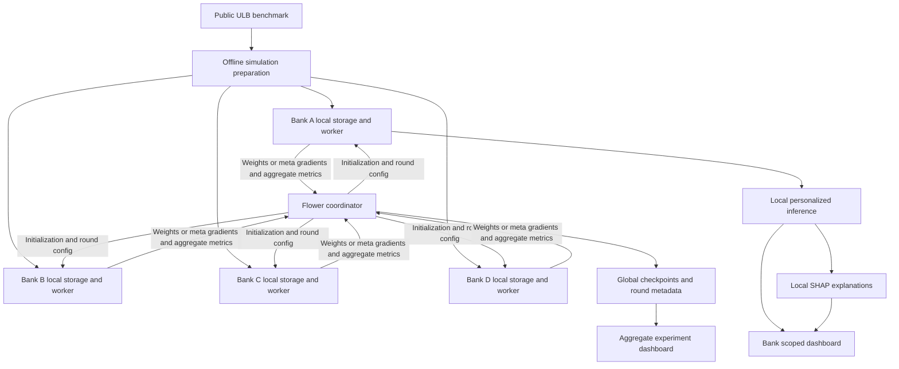

# System architecture

## Purpose and scope

This reproducible research application compares independent local models, a centralized reference, FedAvg, and federated first-order MAML, then explains personalized predictions locally. The supplied project design document was the requirements reference; measured results and limitations are in [STUDY_REPORT.md](STUDY_REPORT.md).

Primary scope is the ULB dataset and four simulated clients called Bank A through Bank D. No real bank identities, geographic categories, merchant meanings, or live banking integrations are inferred. IEEE-CIS, differential privacy, secure aggregation, LIME, and cloud deployment are optional extensions after the core project is complete.

## Logical architecture



Every bank contains the same data loader, preprocessing, model, local trainer, personalization, evaluator, and explanation components. The diagram expands inference for Bank A only for readability.

The offline preparation tool necessarily accesses the public benchmark to construct simulated clients. It is a research setup utility, outside the federated coordinator. A centralized reference also deliberately pools benchmark training data in an isolated experiment. Neither behavior is part of federated training.

## Technology decisions

| Layer | Choice | Responsibility |
| --- | --- | --- |
| Runtime | Windows x64 and Python 3.13 | Shared research application |
| Model | PyTorch | MLP, gradients, adaptation, checkpoints |
| Federation | Flower with custom strategy | FedAvg and explicit first-order meta-gradient transport |
| Data | pandas, NumPy, scikit-learn | Validation, partitioning, local transforms, metrics |
| Explanations | SHAP | Local feature contributions |
| Interface | Streamlit and Plotly | Research dashboard and result exploration |
| Persistence | JSON, CSV, Parquet, local checkpoints | Dataset, model, run, and study artifacts |
| Verification | pytest | Leakage, algorithm, serialization, and integration checks |

The tested route is CPU-compatible native Windows with a pinned Python environment. Federated training launches one Flower SuperLink and four SuperNodes on localhost using ClientApp and ServerApp. The process-based deployment does not require WSL2. The synthetic `flower-smoke` diagnostic remains separate from real model training.

The Streamlit dashboard invokes the package's data, model, evaluation, and explanation functions. Its service module loads saved artifacts and validates uploaded CSVs. An explicit training action starts a separate worker process; page reruns do not start training.

## Repository layout

```text
Minor Project/
  pyproject.toml
  requirements.lock
  README.md
  configs/                    # application and baseline settings
  src/fraud_detection/
    config.py
    cli.py
    data/                     # schema, manifests, splits, partitioning, transforms
    models/                   # shared MLP and checkpoint format
    training/                 # local and centralized training
    federated/                # Flower client, server, message schema, strategies
    meta/                     # support/query sampler, inner loop, meta gradients
    evaluation/               # thresholds, metrics, comparisons, curves
    explainability/           # local background, explainer, plots
    dashboard/                # views, saved-artifact service, background worker
  tests/                      # unit, integration, end to end
  scripts/                    # setup and unified launch commands
  data/raw/                   # ignored benchmark files
  clients/bank_a/              # repeated for banks b, c, d; ignored local artifacts
    data/
    preprocessing/
    models/
    explanations/
  runs/baselines|federated|meta/  # checkpoints, rounds, per-bank metrics
  runs/study/                # generated experimental tables and figures
  docs/
```

`data/`, `clients/`, `runs/`, and Python environments are generated locally and ignored by version control. The application is one Python package with shared model, data, metric, and interface code.

## Data pipeline and leakage controls

1. Obtain ULB through its published source, subject to the source's access requirements. Record source, retrieval date, SHA-256, schema, actual rows, fraud counts, and exclusions. Expected reference counts in the supplied document are 284,807 rows and 492 fraud cases; mismatches require investigation, not silent rewriting.
2. Validate Time, Amount, V1 through V28, and binary Class. Reject nonfinite features, missing columns, or invalid labels with an actionable report. Record duplicate policy; keep exact duplicate groups together across splits to avoid identical records crossing partitions.
3. Assign stable row identifiers and reproducibly partition into four clients using label-based Dirichlet allocation. Concentrations are 10.0 for mild and 0.5 for strong heterogeneity. Save allocations, seeds, sizes, and label distributions; bank names carry no business meaning.
4. Split each client into approximately 70/15/15 train/validation/test partitions while preserving its allocated prevalence through stratification. Minimum class counts permit disjoint support/query batches and evaluable validation/test sets. Partition seeds use a documented, bounded feasibility policy. No fraud samples are manufactured in evaluation sets.
5. Fit a bank-local scaler for Time and Amount on training rows only; preserve the PCA feature order. Every method uses that client's same transform for fair comparison. The centralized reference pools the locally transformed training examples and uses the corresponding bank transform at evaluation. Record that local scaling changes the coordinate mapping across banks. A fixed, data-independent common transform can be evaluated separately if this materially affects shared learning.
6. Split training rows into disjoint support/query samples per meta episode. Query data here belongs to training, not validation. Validation selects hyperparameters and thresholds; test remains untouched until final evaluation. Training rows may recur across different episodes, never on both sides of the same episode.
7. Local, centralized, and FedAvg training use train-derived positive class weights. The meta-learning episodes use class-balanced support and query sampling. No SMOTE or synthetic transaction generation is used.

The delivered study uses stratified random partitions. A temporal holdout is outside its measured scope and would require a separate experiment.

## Model and learning protocols

Use a 30-input MLP for the unmodified ULB features: Linear(30,64), ReLU, Dropout(0.2), Linear(64,32), ReLU, Linear(32,1). Feature selection must update the recorded input schema. Train raw logits with BCEWithLogitsLoss; sigmoid is applied for reported scores. Scores are not claimed to be calibrated probabilities without calibration analysis.

### Local and centralized references

Local-only trains one model per bank using Adam. The centralized reference trains the same architecture on pooled public benchmark training data. Local, centralized, and FedAvg use five full-data training cycles and the same partitions, feature schema, evaluation code, and seed list. FedMAML uses five cycles of much smaller support/query episodes; [EVALUATION_PROTOCOL.md](EVALUATION_PROTOCOL.md) quantifies the exposure difference. Centralization is a reference, not a guaranteed performance upper bound.

### FedAvg

The coordinator sends the current weights and round settings. Each participating bank trains a local copy and returns parameters plus the count of original local training examples. The coordinator averages weights by these counts, not by synthetic/resampled counts. Require all four clients in the initial research configuration. Abort a round on malformed updates or missing clients; resumable execution must not apply a partial or duplicate round silently.

### Federated first-order MAML

For each round, broadcast initialization theta. Each bank starts from a fresh copy and performs K SGD support steps with inner learning rate alpha:

`phi_i = adapt(theta, support_i, K, alpha)`

The bank computes `g_i = gradient_phi_i loss(query_i, phi_i)`. First-order MAML ignores the derivative through the inner adaptation. Send this query gradient, not adapted model weights, to the server. With four equal-weight tasks, the server updates `theta = theta - beta * mean(g_i)`. Initial outer optimization uses SGD for transparent verification. An Adam outer optimizer is a separate logged configuration.

Use the same ordered parameter names and shapes for every message. Reject stale round IDs, mismatched schemas, nonfinite gradients, and incorrect algorithm tags. Keep FedAvg parameter messages and meta-gradient messages distinct. A scalar query loss alone is insufficient for the server update. This design follows the MAML support adaptation/query objective, using its first-order approximation; it is not second-order MAML.

Numerical tests check the manual gradient update, support/query disjointness, unchanged global initialization during bank adaptation, and stale-message rejection. The saved study uses five rounds, one support step, inner learning rate 0.01, outer learning rate 0.001, and 32 support plus 32 query examples per bank and round. These settings are measured research choices, not claimed optimal.

### Personalization

Freeze the selected initialization. Adapt a separate copy for each bank using only a recorded training support subset. Tune that model's decision threshold on its bank validation data. Evaluate untouched test data before and after adaptation. Saved results include support budgets of 32, 128, and 512 examples and adaptation steps of 1, 3, and 5. Support sampling enriches fraud examples up to half the budget, bounded by available fraud rows, so its prevalence is not representative of deployment.

The core claim is adaptation to four participating simulated banks. Generalization to unseen banks requires a separately labeled leave-one-client-out experiment.

## Service and artifact contracts

| Contract | Required content |
| --- | --- |
| Dataset manifest | Source, checksum, schema version, exclusions, row IDs, split and client allocation, counts, seeds |
| Run configuration | Run ID, algorithm, seed, split manifest hash, model config, optimizer settings, versions, device, revision when available |
| Client update | Run/round/client IDs, algorithm, base model hash, ordered tensor schema, weights OR gradients, permitted aggregate counts/metrics |
| Model bundle | Model state, schema and feature order, local preprocessing reference, threshold, client ID, parent run and model hash |
| Prediction | Local record reference, client ID, model version, score, threshold, decision |
| Explanation | Local record reference, model and background hashes, feature values and SHAP values, expected value, output scale |
| Evaluation | Run/client/model IDs, split, counts, prevalence, threshold, metrics, undefined reasons, adaptation settings |

The command line provides data preparation, local and federated training, bank-local explanation, saved-run verification, study generation, and dashboard launch. The dashboard service loads the same saved models and metrics for held-out or validated CSV predictions. The offline public-benchmark evaluator reads test partitions after federated training; the Flower coordinator does not.

Federated run records progress through training, federated completion, completed evaluation, or failure. Each round checkpoint and JSON report is written atomically with its model hash and audit fields. Existing run directories are refused instead of resumed or overwritten. Local preprocessing is stored under each bank. The coordinator does not need that bank's raw inference records or SHAP artifacts.

Project run metadata uses JSON and CSV, while tensors remain local checkpoint files. Flower's local runtime manages its own internal state; the application does not maintain a separate SQLite model registry. A failed run remains visible with its reason and is never shown as a completed experiment.

## Explanations and interface

The bank-local SHAP KernelExplainer uses a bounded training background of 32 rows by default, up to 100, and explains selected test transactions on demand. The predictor returns the sigmoid fraud score. The artifact records approximation budget and seed, and verifies that expected probability plus contributions reconstructs the score within 0.001. Dropout is disabled during prediction and explanation.

Cache explanations by model, preprocessing, background, and transaction hashes. Changing any component invalidates the cache. ULB PCA features retain their original names and no invented business meaning. SHAP describes the model's associations, not proof of fraud or causality.

The dashboard provides:

- Overview: dataset statistics, simulated-client labels, available completed runs.
- Transaction detection: bank-scoped sample selection or validated CSV input, score, threshold, decision, model version. Provide dataset samples because entering 28 PCA values manually is impractical.
- Explanation: local waterfall/bar chart, feature contributions, output scale, PCA caveat.
- Federated learning: actual round state, participants, duration, aggregate loss, transferred tensor bytes, failures.
- Model comparison: per-client results, macro summaries, and a bank F1 chart.
- Training: an explicitly started background Flower run with persisted worker status.

The local demo switches bank contexts in one interface. This is a demonstration convenience, not a security boundary. Training runs in a worker process; page reruns do not start training.

## Evaluation and completion criteria

Required predictive comparisons are local-only, centralized, FedAvg, and first-order FedMAML. FedMAML plus SHAP uses the identical checkpoint; it is not a fifth predictive improvement claim.

Report precision, recall, F1, ROC-AUC, average precision (explicitly named AP rather than ambiguously mixing PR-area definitions), false positive rate, confusion counts, prevalence, and selected threshold. Default threshold rule maximizes validation F1 with a deterministic tie rule favoring higher recall. Any alternative operating constraint is declared before test evaluation.

Report each bank and macro average across valid banks. Pooled confusion counts can produce micro precision/recall/F1/FPR without sharing transactions. Mean client AP is not pooled AP. Keep ROC/PR scores and curves local in the federated path; an explicitly labeled offline public-benchmark evaluator may compute pooled ranking metrics separately. Single-class ROC-AUC and other undefined quantities are null with reasons, never silently zero.

The measured matrix covers four training methods, two heterogeneity settings, and three seeds on fixed split manifests. The [study report](STUDY_REPORT.md) gives mean and standard deviation, per-bank outcomes, adaptation sensitivity, round duration, and approximate tensor bytes. Communication figures exclude protocol overhead. The observed FedMAML configuration does not outperform the baselines; few positive cases and fixed partitions limit certainty.

Correctness gates cover no split overlap, train-only fitting, local-only raw data access, numerical meta-update correctness, valid checkpoint reloads, schema rejection, explanation reconstruction, and one complete dashboard prediction-to-explanation workflow. Scientific completion requires measured reproducible comparisons even if personalization does not win.

## Privacy and operational boundaries

Bind local development services to localhost. Require TLS for cross-host client/server communication and keep credentials outside tracked files. Exclude raw data, local records, checkpoints, secrets, and per-transaction logs from version control. Logs contain IDs and aggregate values rather than raw features.

Separate local client storage from coordinator access through application interfaces and test these boundaries. Single-machine simulation does not provide physical isolation. Ordinary federation and TLS do not hide individual updates from the coordinator or provide formal differential privacy. Secure aggregation and differential privacy are deferred extensions and must not appear as implemented protections.

## References

- Requirements: Final_Project_Document_Federated_Meta_Learning_Fraud_Detection.docx, supplied by the user, November 2026.
- MAML original paper: https://proceedings.mlr.press/v70/finn17a.html
- Flower framework: https://flower.ai/docs/framework/
- Flower deployment runtime: https://flower.ai/docs/framework/1.43/en/how-to-run-flower-with-deployment-engine.html
- SHAP KernelExplainer API: https://shap.readthedocs.io/en/stable/generated/shap.KernelExplainer.html
- Verified ULB dataset copy used in this project: https://zenodo.org/records/7395559
